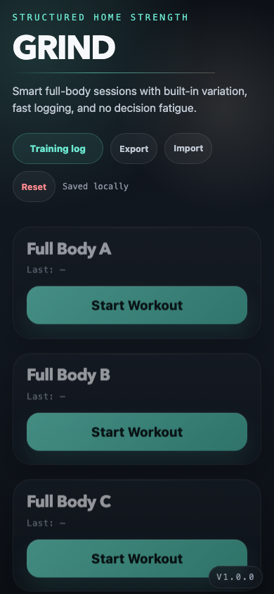
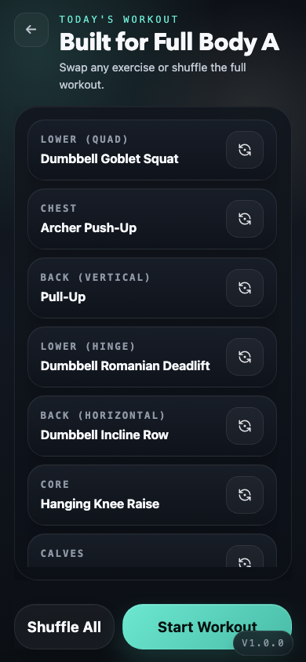
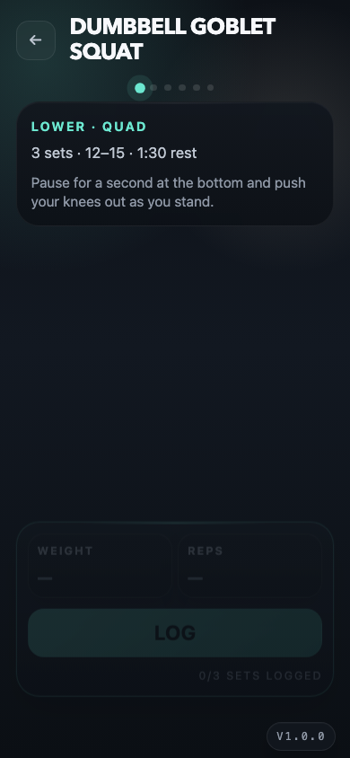
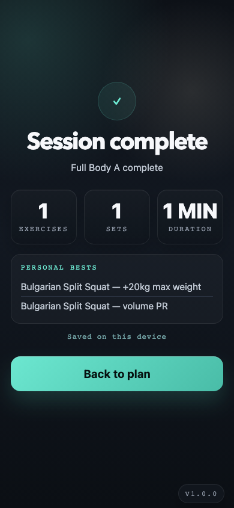

# Grind

> An offline-first workout PWA with structured variety, fast set logging, and
> no account required.

[](https://github.com/tomer-liran/grind/actions/workflows/ci.yml)
[](LICENSE)
[](vite.config.mjs)

Grind runs an A/B/C full-body split. It chooses one exercise for each movement
slot, lets you swap anything before training, logs sets and rest, and derives
personal-best and overload signals from completed sessions.

The project is deliberately small: vanilla JavaScript, Vite, CSS, and browser
storage. Fork it, edit one file to match your equipment, and deploy it to any
static host.

## Screenshots

| Home                                                               | Workout plan                                                                | Set logging                                                      | Session complete                                                             |
| ------------------------------------------------------------------ | --------------------------------------------------------------------------- | ---------------------------------------------------------------- | ---------------------------------------------------------------------------- |
|  |  |  |  |

## What works

- **Structured variety** — fixed movement patterns with randomized exercises;
  repeats are avoided until a category pool is exhausted.
- **Fast logging** — per-set weight and reps, bodyweight-aware inputs, previous
  values, background-safe rest timers, and superset rounds.
- **Progress** — max-weight and volume PRs, estimated one-rep-max charts, and a
  conservative three-session overload prompt.
- **Reliable local data** — versioned state, legacy migration, atomic session
  completion, recoverable write failures, and backup import/export.
- **Training log** — expandable history, safe deletion, undo, and projection
  rebuilds for weekly completion and PRs.
- **Offline PWA** — installable, self-contained artwork, no third-party fonts,
  and no analytics.
- **Optional sync** — an idempotent webhook outbox with retry/backoff. Disabled
  by default.
- **Accessible interaction** — semantic controls, keyboard navigation, dialog
  focus management, 200% zoom support, 44px targets, and reduced motion.

## Run locally

Requirements: Node.js `^20.19.0` or `>=22.12.0`.

```bash
git clone https://github.com/tomer-liran/grind.git
cd grind
npm ci
npm run dev
```

Open `http://localhost:5173`.

```bash
npm run check      # format, lint, types, unit tests, repo validation, build
npm run test:e2e   # Chromium and WebKit mobile flows
npm run preview    # preview the production PWA
```

## Customize the workout

All workout content lives in [`src/data/workouts.js`](src/data/workouts.js).
Each exercise has a stable ID, display name, prescription, rest duration, and
coaching cue:

```js
{
  id: "cable-chest-press",
  name: "Cable Chest Press",
  sets: 4,
  repsRange: "8–12",
  restSeconds: 90,
  tip: "Drive both handles forward together.",
}
```

Add it to a category pool, or create a new category and reference that key from
a slot in `DAYS`.

Stable IDs matter: history and PRs use `id`, so a display name can change
without breaking progress. Do not reuse or casually replace an existing ID.
Validation fails when a pool is empty, an ID is duplicated, or a slot points to
missing data.

Adjacent slots with the same `supersetGroup` are trained round-robin:

```js
{ id: "c-arms-tricep", key: "arms-tricep", label: "ARMS · TRICEP", supersetGroup: "arms-c" },
{ id: "c-arms-bicep", key: "arms-bicep", label: "ARMS · BICEP", supersetGroup: "arms-c" },
```

## Data, privacy, and backups

Grind has no account and no first-party server. Its canonical state is a
versioned `grind:state` record in `localStorage`. On first launch after an
upgrade, legacy `grind:*` records are imported without deleting the originals.

Use **Export** on the Home screen before clearing browser data or testing a
migration. **Import** accepts a Grind JSON backup. **Reset** removes both the
current state and legacy Grind records on that device.

The default build makes no runtime requests beyond its own static files.

### Optional webhook sync

Edit [`src/config.js`](src/config.js) to enable sync:

```js
export const DEFAULT_CONFIG = {
  versionLabel: `v${__APP_VERSION__}`,
  webhookUrl: "https://your-endpoint.example/workouts",
  dryRun: false,
};
```

The browser sends session ID, date, template, duration, sets, volume, PR flags,
and timestamps. The session ID is also sent as an `Idempotency-Key` header.
Failed deliveries remain in a bounded local outbox and retry when the app is
online.

A URL bundled into client JavaScript is not a secret. The endpoint must handle
authentication, CORS, rate limiting, validation, and idempotency.

## Architecture

```text
src/
  domain/          pure calendar, session, superset, progress, plan rules
  infrastructure/  versioned state migration and atomic repository operations
  app/             browser orchestration, screens, logging, sync, history
  ui/              reusable dialog/focus behavior
  data/            workout catalog and A/B/C templates
  styles/          tokens, base, components, and screens
tests/
  *.test.js        Vitest domain and repository coverage
  e2e/             Playwright mobile flows and accessibility checks
```

See [`docs/ARCHITECTURE.md`](docs/ARCHITECTURE.md) for the state model,
transaction boundaries, and sync flow. See [`docs/LOGIC.md`](docs/LOGIC.md) for
the core algorithms.

## Self-host

`npm run build` writes a static site to `dist/`.

- Vercel, Netlify, or Cloudflare Pages: build `npm run build`, publish `dist`
- GitHub Pages: enable Pages and use a static deployment workflow
- Any web server: serve `dist` with SPA fallback to `index.html`

HTTPS is required for service workers outside localhost. Installability and
storage eviction rules still vary by browser and operating system.

## Browser support and limitations

CI covers current Chromium and WebKit mobile engines. Current Firefox should
work, but is not yet in the automated browser matrix.

Current product limits:

- Display and overload increments are kilogram-oriented.
- Data does not sync between devices unless you configure a webhook.
- Browser storage can be evicted; export backups for data you care about.
- Exercise suggestions assume the equipment described in the checked-in pools.

Grind is a logging tool, not medical advice. Train within your experience and
seek qualified guidance for pain, injury, or health concerns.

## Contributing

Start with [`CONTRIBUTING.md`](CONTRIBUTING.md). Security reports belong in the
private channel described in [`SECURITY.md`](SECURITY.md); usage questions
belong in [`SUPPORT.md`](SUPPORT.md).

## License

[MIT](LICENSE) © Tomer Liran.
